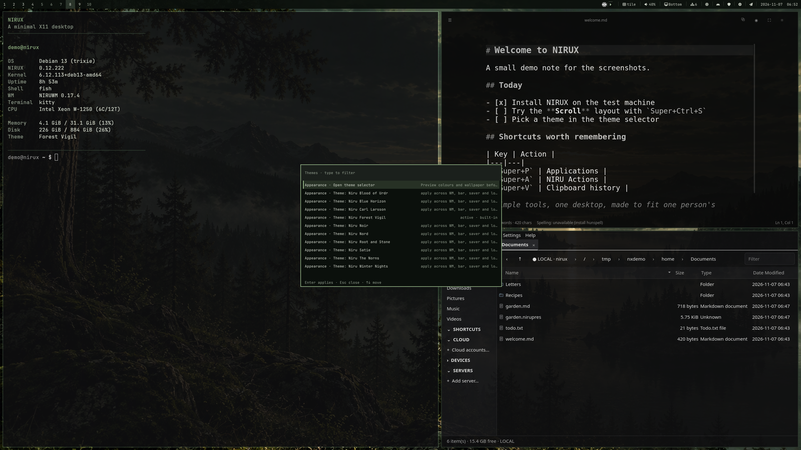

# NIRUX

A minimal, native X11 desktop suite for Linux, built by me, for me.

**Status: beta** · The hub of the NIRUX suite · [MIT License](LICENSE)



## About

NIRUX is my personal desktop: a tiling window manager, status bar, keyboard-first
launcher, notifications, lock screen, screensaver, screenshots, screen recording,
themes, wallpaper and display tools, installed and updated together as one
verified suite. This repository is the hub. It holds the installer
(`nirux`), the pinned component versions ([manifest](manifest)), session
integration, sounds, greeter themes and the shared documentation.

It is heavily inspired by **dwm**, which I used for many years, but it is not a
dwm fork, a dwm configuration or a copy of dwm. The window manager, session
layer, bar, launcher and tools are their own code and their own design.

**NIRU** is my personal mark, from my name, Nicklas Rudolfsson. The programs are
named NIRUWM, NIRUBAR, NIRULAUNCHER and so on because they belong to that family
of tools. **NIRUX** adds the X: it is the X11 desktop built from those programs.

- **NIRU** programs form the program family. Some are useful outside the
  desktop, and the toolkit-based apps (for example the Qt/PySide apps
  NIRUNOTE, NIRUORG, NIRUPRES and NIRUFLOW) can run under Wayland where their
  toolkit allows it.
- **NIRUX** is the X11 desktop and the supported session. NIRUWM, NIRUBAR,
  NIRU Launcher, NIRUNOTIFY, NIRULOCK, NIRUSCREENSAVER, NIRUSHOT, NIRU Display,
  NIRU Wallpaper and NIRUGESTURED depend on X11 (EWMH, atoms, struts, the root
  window, X11 input). They are not advertised as working under Wayland.

### Why Debian, Arch and Void

I focus on these three distributions because they are the three ways I actually
use a computer:

| Distribution | How I use it |
|---|---|
| **Debian** | My main choice, especially on my music computers and DAWs. I want a stable base when I work with audio, sessions and recordings. |
| **Arch** | My laptop and my rolling-release choice, for newer packages and living a little closer to the edge. |
| **Void** | A fast, systemd-free alternative. It keeps NIRUX honest about not assuming one init system or one package-manager culture. |

I occasionally use other distributions too, but NIRUX is deliberately focused on
these three, and I have no plans to change that.

## The suite

Every repository below is part of NIRUX and follows the same README layout. The
status labels are explained in [Status, disclaimer and how it's made](#status-disclaimer-and-how-its-made).

### Core components

Installed by `nirux install` and updated together by `nirux update` as one
verified generation, at the versions pinned in [manifest](manifest).

| Component | What it does | Status |
|---|---|---|
| [nirux](https://github.com/nirucon/nirux) | Installer, update/rollback, suite pins, session integration, sounds (this repo) | beta |
| [niruwm](https://github.com/nirucon/niruwm) | Tiling window manager, workspaces, `niructl`, `niruidle`, clipboard and gesture helpers | beta |
| [nirubar](https://github.com/nirucon/nirubar) | Per-monitor status bar, panels, Quick Settings, tray, Tailscale and tasks | beta |
| [nirulauncher](https://github.com/nirucon/nirulauncher) | Applications, windows, clipboard, settings and NIRU Actions | beta |
| [nirunotify](https://github.com/nirucon/nirunotify) | Notification service, Do Not Disturb, history, hardware OSD and event sounds | beta |
| [nirulock](https://github.com/nirucon/nirulock) | PAM lock screen with themed CAVA visualizer or quotes | beta |
| [niruscreensaver](https://github.com/nirucon/niruscreensaver) | Idle screen with themed CAVA visualizer or quotes | beta |
| [nirushot](https://github.com/nirucon/nirushot) | Screenshot capture, review and annotation | beta |
| [niruclip](https://github.com/nirucon/niruclip) | Screen, region and camera recording with profiles and recovery | alpha |
| [niruwallpaper](https://github.com/nirucon/niruwallpaper) | Wallpaper selection, scale, rotation and output | beta |
| [nirudisplay](https://github.com/nirucon/nirudisplay) | Monitor layout, modes, rotation and profiles | beta |
| [niruthemeselector](https://github.com/nirucon/niruthemeselector) | Theme browsing and application | beta |
| [nirulogin](https://github.com/nirucon/nirulogin) | Minimal greetd/X11 login for NIRUWM | alpha |
| [niruwebapp](https://github.com/nirucon/niruwebapp) | Web apps in their own windows with isolated or shared profiles | alpha |
| [nirufetch](https://github.com/nirucon/nirufetch) | NIRU-styled system summary for the terminal | beta |
| [nirushare](https://github.com/nirucon/nirushare) | Trusted text and image sharing over Tailscale | alpha |

### Extras

Optional suite apps with their own release cadence. They are **not** installed
by `nirux install` or `nirux update`; install only the ones you want with
`nirux extras install NAME` (see [Extras](#extras-1) below).

| Extra | What it does | Status |
|---|---|---|
| [niruorg](https://github.com/nirucon/niruorg) | File and folder management | beta |
| [nirunote](https://github.com/nirucon/nirunote) | Minimal Markdown editor | beta |
| [nirupres](https://github.com/nirucon/nirupres) | Presentation studio | beta |
| [nplay](https://github.com/nirucon/nplay) | Terminal music, radio and podcast player; also fully standalone | beta |
| [niruamp](https://github.com/nirucon/niruamp) | Graphical, Winamp-inspired frontend for NPLAY (requires NPLAY) | alpha |
| [niruflow](https://github.com/nirucon/niruflow) | Local maintenance and automation | beta |
| [nirusec](https://github.com/nirucon/nirusec) | Firewall, ports, updates, firmware and security overview | alpha |
| [nirugame](https://github.com/nirucon/nirugame) | Steam, RetroArch and native games, with optional user-supplied SID music | alpha |
| [niruremote](https://github.com/nirucon/niruremote) | Graphical remote desktop over Tailscale and SSH | alpha |
| [nirudictate](https://github.com/nirucon/nirudictate) | Local speech-to-text dictation with `Ctrl+Alt+Space` | alpha |

### Accessories

Themes, artwork and small shared pieces.

| Repository | What it is | Status |
|---|---|---|
| [nirux-wallpapers](https://github.com/nirucon/nirux-wallpapers) | Optional 4K/8K wallpapers for the built-in themes (release assets) | beta |
| [nirux-theme-carl-larsson-blue](https://github.com/nirucon/nirux-theme-carl-larsson-blue) | Theme pack: Carl Larsson Blue | beta |
| [nirux-theme-carl-larsson-green](https://github.com/nirucon/nirux-theme-carl-larsson-green) | Theme pack: Carl Larsson Green | beta |
| [nirux-theme-carl-larsson-jul](https://github.com/nirucon/nirux-theme-carl-larsson-jul) | Theme pack: Carl Larsson Jul (Christmas) | beta |
| [nirux-theme-carl-larsson-noir](https://github.com/nirucon/nirux-theme-carl-larsson-noir) | Theme pack: Carl Larsson Noir | beta |
| [nirux-theme-carl-larsson-red](https://github.com/nirucon/nirux-theme-carl-larsson-red) | Theme pack: Carl Larsson Red | beta |
| [nirux-theme-erik-satie-blue](https://github.com/nirucon/nirux-theme-erik-satie-blue) | Theme pack: Erik Satie Blue | beta |
| [nirux-theme-erik-satie-green](https://github.com/nirucon/nirux-theme-erik-satie-green) | Theme pack: Erik Satie Green | beta |
| [nirux-theme-erik-satie-noir](https://github.com/nirucon/nirux-theme-erik-satie-noir) | Theme pack: Erik Satie Noir | beta |
| [nirux-theme-erik-satie-red](https://github.com/nirucon/nirux-theme-erik-satie-red) | Theme pack: Erik Satie Red | beta |
| [nirux-theme-evert-taube](https://github.com/nirucon/nirux-theme-evert-taube) | Theme pack: Evert Taube | beta |
| [nirux-theme-hackermanoldschool](https://github.com/nirucon/nirux-theme-hackermanoldschool) | Theme pack: Hackerman Oldschool | beta |
| [nirux-theme-hackermanretro](https://github.com/nirucon/nirux-theme-hackermanretro) | Theme pack: Hackerman Retro | beta |
| [nirux-theme-piaf-noir](https://github.com/nirucon/nirux-theme-piaf-noir) | Theme pack: Piaf Noir | beta |
| [nplay-themepack](https://github.com/nirucon/nplay-themepack) | Ten classic colour schemes for NPLAY | beta |
| [nplay-themepackniru](https://github.com/nirucon/nplay-themepackniru) | Five Norse-inspired palettes for NPLAY | beta |
| [nirux-ipc](https://github.com/nirucon/nirux-ipc) | Small Rust crate: X11 root-property state contract between components | dev |

### How it fits together

- **`nirux`** (this repo) installs a *generation*: the core binaries at the
  versions in `manifest`, downloaded as release assets and checked against
  SHA-256 sums, under `~/.local/share/nirux/generations/`, with
  `~/.local/share/nirux/current` pointing at the active one and links in
  `~/.local/bin`. It also installs runtime packages, the session, the login
  integration, sounds and the terminal theme hook.
- **NIRUWM** owns the session. `niruwm-session` starts NIRUWM together with
  NIRUNOTIFY, `niruidle` (which runs NIRUSCREENSAVER and then NIRULOCK), the
  clipboard and the gesture helpers; NIRUWM starts one NIRUBAR per monitor.
  `niructl` is the command-line control for the running window manager.
- **One theme, everywhere.** A theme in `~/.config/niruwm/themes/` (the ten
  built-ins or a user theme pack) is followed by the WM, bar, launcher,
  notifications, lock, screensaver, NIRUSHOT and the toolkit apps that choose
  *Follow NIRUX*. NIRU Theme Selector and NIRU Wallpaper are the graphical front
  ends.
- **NIRU Launcher** is the hub for everything interactive: apps, windows,
  clipboard, NIRU Actions, Wi-Fi, Bluetooth, displays, power, themes and sound.
  NIRUBAR's panels and Quick Settings open the same views.
- **Extras** are separate apps with their own installers. NIRUX pins one
  version of each, downloads it on request, verifies it and runs the project's
  own installer.

## Features

- **NIRUWM:** eight layouts (tile, left, monocle, centered, centered-floating,
  fibonacci, floating and Scroll), per-monitor workspaces with per-workspace
  layouts, floating, fullscreen, gaps, master count and ratio, sticky windows,
  window rules, session state and saved window placement.
- **Scratchpads:** `Super+Shift+S` shows or hides a terminal above whatever you
  are doing; `Super+Alt+1…9` are nine more, and `Super+Alt+Shift+1…9` sends any
  window to one of them (the same key on that window takes it back). One is
  shown at a time, it follows you across workspaces and screens, and it never
  moves or resizes the windows underneath. Slots can start their own program in
  `[[scratchpad.slot]]`.
- **NIRUBAR:** workspaces, title, media, volume, microphone, brightness,
  network, Wi-Fi, battery, mode, tasks, updates, calendar, an optional
  Tailscale module, XEmbed and StatusNotifierItem trays, and Quick Settings
  (volume, microphone, Wi-Fi, Bluetooth, displays, power profile, themes, DND,
  idle inhibition, night light and lock in one view).
- **NIRU Launcher:** applications, windows, NIRU Actions, web search, Wi-Fi,
  Bluetooth, displays, power, themes, sound, input, screenshots and recording.
  Deterministic phrases such as "lock", "focus mode" or "volume up" resolve to
  native actions with no account, model or network request.
- **Clipboard history** on `Super+V`, stored locally in
  `~/.local/state/niru/clipboard.json`, capped at 200 entries, filtered for
  obvious secrets and never uploaded.
- **Themes and wallpaper:** ten built-in themes, user theme packs, wallpaper
  scale, rotation, output selection and follow-theme behaviour.
- **NIRU Display:** stable screen numbers, EDID identity, snapping, mirror
  groups, profiles and safe preview transactions.
- **Notifications, lock and idle:** native notifications with DND and history,
  a PAM lock screen and an idle screensaver, both with CAVA, minimal, terminal,
  runic and corner layouts that follow the theme.
- **Capture:** NIRUSHOT for full-screen, region and window screenshots with
  review and annotation; NIRUCLIP for screen, region and camera recording.
- **Event sounds:** one family of short, soft sounds in five categories, each
  switchable, with per-app notification sounds. See [Sounds](docs/SOUNDS.md).
- **NIRU Login:** a minimal greetd/X11 login (Swedish keyboard layout by
  default, clickable layout selector, clock, power actions). SDDM, LightDM and
  startx remain available.
- **Safe updates:** verified downloads, a kept previous generation, rollback,
  automatic pruning, and *update and power off/restart* from the power menu.

## Requirements

- **Arch Linux, Debian or Void Linux (glibc)** on x86_64.
- A normal user with `sudo`, network access and `git`.
- X11 with working graphics drivers and firmware. NIRUX installs desktop
  runtime packages, not an operating system or GPU drivers; driver and firmware
  problems belong to the distribution.
- Released binaries do not support Wayland, Void musl or other architectures.

## Installation

Run as your normal desktop user, **not in a root shell**:

```sh
git clone https://github.com/nirucon/nirux
cd nirux
./nirux install
```

The installer downloads versioned release assets, verifies their checksums and
installs under `~/.local` by default (`NIRUX_PREFIX` changes it; use the same
prefix for later commands). It preserves an existing display manager. A fresh
installation defaults to **NIRU Login**, with startx, SDDM and LightDM as
explicit choices:

```sh
./nirux install --display-manager auto|startx|nirulogin|sddm|lightdm
```

Other install options choose the browser (`--browser helium|none|keep`), the
optional theme wallpapers (`--wallpapers all|default`), LocalSend, OpenCode and
Papirus icons. `--minimal` / `--no-packages` installs binaries and integration
only, for systems where the runtime packages already exist. Run
`nirux --help` for every option and read [Installation](docs/INSTALL.md) for
session choices, desktop integration and upgrading from NIRUPI/dwm.

Log out and choose the NIRUWM session (or reboot into NIRU Login).

### Extras

```sh
nirux extras list              # pinned, installed and selected extras
nirux extras status
nirux extras install niruflow  # download the pinned version, verify, run its installer
nirux extras select niruflow   # remember it for updates without installing
nirux extras update            # update the selected extras to their pins
nirux extras unselect niruflow
```

NIRUAMP is only a frontend and needs NPLAY: `nirux extras install niruamp`
installs or updates the pinned NPLAY first. NPLAY alone is fully supported, with
or without NIRUX. Details in [Optional extras](docs/EXTRAS.md).

### Theme packs and wallpapers

```sh
nirux wallpapers download themes   # the nine optional theme wallpapers (4K/8K)
nirux wallpapers download extras   # Carl Larsson and Erik Satie colour variants
nirux wallpapers status
```

A theme pack is installed from its own repository with `./install.sh` and
selected with `niructl theme ID`. See [Wallpapers and packs](docs/WALLPAPERS.md).

## Usage

### Key bindings at a glance

| Binding | Action |
|---|---|
| `Super+Return` | Terminal |
| `Super+P` | Applications |
| `Super+A` | NIRU Actions |
| `Super+Shift+P` | Applications, windows, actions and settings in one view |
| `Super+S` | Web search |
| `Super+V` | Clipboard history |
| `Alt+Tab`, `Super+W`, `Super+grave` | Window switcher |
| `Super+1…9`, `Super+0` | Go to workspace 1…10 |
| `Super+Shift+1…9` | Move the focused window to a workspace |
| `Super+T` / `Super+M` / `Super+F` | Tile / monocle / floating layout |
| `Super+Ctrl+S` | Scroll layout |
| `Super+Ctrl+Shift+S` | Toggle one or two Scroll columns |
| `Super+Shift+Space` | Toggle floating |
| `Super+Shift+E` | Toggle fullscreen |
| `Super+Alt+S` | Toggle sticky for the focused window |
| `Super+Shift+S` | Show / hide the default scratchpad |
| `Super+Alt+1…9` | Show / hide scratchpad 1…9 |
| `Super+Alt+Shift+1…9` | Send the focused window to scratchpad 1…9 (again: take it back) |
| `Print` / `Super+Print` / `Super+Shift+Print` | Screenshot of a region / the screen / a window |
| `Super+Escape` | Lock |
| `Super+Q` | Close the focused window |
| `Super+Shift+R` | Reload configuration |

The full list is in the [NIRUWM README](https://github.com/nirucon/niruwm), and
the launcher's keybinding view always shows the effective shortcuts, including
your own overrides.

### The `nirux` command

| Command | What it does |
|---|---|
| `nirux install` / `nirux update` | Install, or update to the newest release (`--release VERSION` for a specific one) |
| `nirux status` / `nirux doctor` | Check programs, integration, PAM and permissions; `doctor` also checks the live session |
| `nirux rollback` | Switch back to the previous program generation |
| `nirux gc [--keep N] [--dry-run]` | Prune old generations (also done after every update) |
| `nirux update-shutdown` / `nirux update-reboot` | Update everything in a terminal, then power off / restart on success |
| `nirux extras ...` | Optional extras, see above |
| `nirux sounds ...` | Event sounds: `status`, `list`, `on`, `off`, `toggle`, `test`, `play`, `app` |
| `nirux wallpapers ...` | Download, inspect or remove optional wallpapers |
| `nirux login-wallpaper list\|set FILE\|reset\|sync` | Wallpaper of the login screen |
| `nirux layout list\|save NAME\|apply NAME\|rotate OUTPUT DIR` | Display layouts from the command line |
| `nirux reset-config` | Reset `~/.config/niruwm/config.toml` to the current example (keeps a `.nirux-backup` copy) |
| `nirux repair-session` / `nirux repair-wallpaper` | Repair the session files or the wallpaper setup |
| `nirux browser-addon bonjourr\|none\|status` | Optional browser start page add-on |
| `nirux remove helium\|localsend\|opencode` | Remove an optional app NIRUX installed |
| `nirux uninstall [--purge]` | Remove NIRUX (see [Uninstall](#uninstall)) |

### Update, rollback and activation

```sh
nirux update
nirux status
nirux rollback
```

Updates keep the previous program generation for rollback; settings and your
own content are preserved. **Log out and back in when WM or session programs
change**: restarting the bar (`niructl restart-bar`) does not replace a running
window manager. Rollback restores programs, not personal files or OS packages.
Old generations are pruned after each update (current, previous, any still used
by a running session and the five newest are kept).

`nirux update-shutdown` and `nirux update-reboot` update the distribution
packages (including kernels), NIRUX and the selected extras in a terminal, so
sudo and package prompts stay visible, and only then power off or restart. They
never force a shutdown and never power off after a failed update. `--dry-run`
prints the plan, `--no-power` leaves the machine running and `--yes` skips the
final confirmation. Firmware and AUR/Flatpak/Snap/Docker updates are not
included. See [Update and power off / restart](docs/UPDATE-POWER.md).

The NIRUBAR update indicator follows the core suite only; extras are updated
with `nirux extras update`.

## Configuration

| File | Purpose |
|---|---|
| `~/.config/niruwm/config.toml` | Window manager and bar settings; start from [config.example.toml](config.example.toml) |
| `~/.config/niruwm/appearance.toml` | Optional colours, font, spacing, focus width, reduced motion; see [appearance.example.toml](appearance.example.toml) and [STYLE.md](docs/STYLE.md) |
| `~/.config/niruwm/themes/NAME.toml` | User themes (take precedence over the appearance file) |
| `~/.config/nirux/sounds.toml` | Event sounds; see [sounds.example.toml](sounds.example.toml) and [SOUNDS.md](docs/SOUNDS.md) |
| `~/.config/nirux/sounds/EVENT.ogg` | Your own sound for any event |
| [displays.example.toml](displays.example.toml) | Example display profiles |

Updates add new defaults to an existing configuration without rewriting your
values, and invalid files are rejected before anything changes.
`niruwm --check-config` and `nirubar --check-config` validate without applying.

Further reading:

- [Installation, session choices and suite features](docs/INSTALL.md)
- [NIRU Actions, tasks and optional OpenCode](docs/ACTIONS.md)
- [Input settings](docs/INPUT.md)
- [Sounds](docs/SOUNDS.md)
- [Wi-Fi backends and limitations](docs/WIFI.md)
- [Wallpapers and theme packs](docs/WALLPAPERS.md)
- [Browser add-ons](docs/BROWSER-ADDONS.md)
- [Optional extras](docs/EXTRAS.md)
- [Style guide](docs/STYLE.md)

## Files and paths

| Path | Contents |
|---|---|
| `~/.local/bin/` | Links to the active programs (`nirux`, `niruwm`, `niructl`, `nirubar`, ...) |
| `~/.local/share/nirux/generations/` | Installed program generations |
| `~/.local/share/nirux/current` | Link to the active generation |
| `~/.local/share/nirux/extras-selected` | Extras remembered for `nirux extras update` |
| `~/.config/niruwm/`, `~/.config/nirux/` | Configuration (see above) |
| `~/.local/state/niruwm/`, `~/.local/state/niru/` | Session state and clipboard history |
| `~/Pictures/Wallpapers/NIRU/` | Theme wallpapers (under your XDG Pictures directory) |

## Troubleshooting

- **Start with `nirux doctor`.** It checks programs, integration, PAM files,
  configured commands and, inside the session, the live control channel.
- **A new release does not seem active:** log out and back in; the running
  window manager is only replaced at a new login.
- **Something broke after an update:** `nirux rollback`, then log in again.
- **The session or wallpaper is in a bad state:** `nirux repair-session` or
  `nirux repair-wallpaper`.
- **A configuration change is ignored:** run `niruwm --check-config` or
  `nirubar --check-config`; invalid files are rejected and the old one is kept.
- **Validating NIRU Login:** keep an established SDDM/LightDM or TTY login
  available until you know the new login works on that machine.
- Wi-Fi backend limits are in [WIFI.md](docs/WIFI.md); session and install
  problems in [INSTALL.md](docs/INSTALL.md).

## Uninstall

```sh
nirux uninstall
nirux uninstall --purge
```

A normal uninstall removes NIRUX-owned links, managed apps, generated session
files and owned system integration, and restores backed-up system files.
Browser profiles, app settings, user themes and wallpaper pictures are kept.
`--purge` also removes the suite's configuration and state directories,
including user themes; back them up first. OS packages and the chosen display
manager are kept. Purge is not a lossless undo of every change; see
[INSTALL.md](docs/INSTALL.md#uninstall).

Extras are removed with each project's own uninstaller.

## Building from source

`nirux` itself is a POSIX shell script; the components are built in their own
repositories and published as release assets. Tests:

```sh
sh tests/integration.sh
sh tests/sounds-contract.sh
python3 tests/terminal-theme.py
```

CI runs ShellCheck and the integration tests on Debian (bookworm, trixie), Arch
and Void containers.

### Release policy

The current release and the immediately previous functional release are the
supported window. Older GitHub Releases and assets are historical and are
removed during cleanup; Git tags and commits remain as release evidence. A
version with a known broken asset is not kept merely because its number is
recent.

## Status, disclaimer and how it's made

**Status: beta.** NIRUX is my daily desktop on several machines running Debian,
Arch and Void, and it is mostly complete for my use; expect rough edges, and
read the installer and back up anything important before changing a working
desktop.

NIRUX and every niru* project are made by me, Nicklas Rudolfsson
([@nirucon](https://github.com/nirucon)), for me. They are tailored to my own
needs, preferences and workflows, on my own machines. If they fit yours too,
that's a nice bonus.

- **Free and open source.** Anyone is free to use, study, change and share
  it under the [MIT License](LICENSE).
- **No guarantees.** There is no warranty of any kind. Use it at your own
  risk, read what you install and keep backups of anything that matters.
- **How it's made.** Some of these projects I built from scratch by hand. In
  more recent releases I have used Claude, Anthropic's AI, to do much of the
  heavy lifting under my direction: I decide what to build and how it should
  behave, and I test it on my own machines. It saves me a lot of time, and
  the result is quite OK.
- **Alpha, beta, dev, and maybe forever.** Most things here are alpha, beta
  or dev, and may stay that way. Maybe one day there will be a real stable
  release, but given how fast development moves, and how I am as a person,
  maybe never :)

| Label | Meaning |
|---|---|
| dev | Under active construction; may not build, install or work yet. |
| alpha | Works on my machines, but incomplete or rough; expect breaking changes. |
| beta | In daily use on my machines and mostly complete; rough edges remain. |

## License

MIT License, see [LICENSE](LICENSE). Copyright (c) 2026 Nicklas Rudolfsson.
